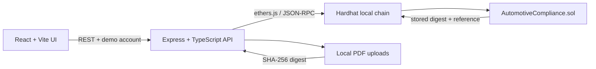

# AutoTrace — Automotive Component Compliance Ledger

An academic end-to-end prototype for component batch registration, laboratory evidence, manufacturer decisions, document integrity and append-only audit history. Solidity on a local Ethereum-compatible chain is the source of truth for batch/test relationships and compliance decisions.

> **Prototype warning:** this is not certified automotive compliance software. A blockchain records submitted assertions; it does not prove a physical test was performed correctly or that an organization is legitimate. Local mnemonic accounts and local-disk uploads are for development only.

## Architecture



## Data relationships

- `batchId = keccak256(UTF-8(batchCode))` gives each human-readable batch code a deterministic `bytes32` ID; the contract also stores `batchCode` for display.
- `testId = keccak256(UTF-8(testCode))` similarly identifies a test. Each `TestRecord` stores its exact `batchId`.
- `batchTests[batchId]` is updated in the same transaction as the test record. Manufacturer batch lookup reads the batch and the indexed test IDs from the contract; no mutable database shadows these relationships.
- Required test types are configured per component type on-chain. Brake pads require hardness, dimension and durability; wheel bearings require hardness and durability.
- The contract rejects approval if required evidence is missing, failed, revoked or expired. A required test revoked after approval changes current status to reassessment-required while the earlier approval event remains in the event history.

## On-chain vs off-chain

| Data | Location | Reason |
|---|---|---|
| Batch, test metadata and parent-child links | On-chain | Shared authoritative traceability |
| Required-test policy, decision, revocation reason | On-chain | Contract-enforced workflow and audit trail |
| SHA-256 PDF digest and document reference | On-chain | Later integrity comparison |
| PDF bytes | Local `backend/uploads/` | Avoid large and confidential documents on-chain |
| Dashboard totals and event views | Rebuilt from chain events | No separate mutable source of truth |

A matching digest shows that retrieved bytes match the bytes represented by the recorded digest. It does **not** prove the report is scientifically true. The demo upload checks the PDF header and MIME type; production should use stronger content inspection, malware scanning, private object storage, access policy and audit logs.

## Stack

- React, Vite, TypeScript, responsive CSS and Lucide icons
- Node.js, Express, TypeScript, Zod, Multer, ethers.js
- Solidity 0.8.28, Hardhat, OpenZeppelin AccessControl
- Contract tests with Hardhat/Chai; backend and UI tests with Vitest/Supertest/Testing Library

## Prerequisites

- Node.js 20+ and npm
- Network access to install packages the first time

## Install and run

From this repository root (PowerShell on Windows):

```powershell
Copy-Item .env.example .env
npm install
```

On macOS/Linux, use `cp .env.example .env` instead.

Start a local chain in terminal 1:

```bash
npm run chain
```

Deploy contracts in terminal 2 (chain must already be running):

```bash
npm run contracts:compile
npm run contracts:deploy
npm run seed
```

`npm run contracts:deploy` writes the contract address and ABI to `backend/src/config/deployment.json`. This generated file is local deployment output and should be regenerated after restarting/redeploying the chain.

Start the backend and frontend in separate terminals:

```bash
npm run backend:dev
npm run frontend:dev
```

Open <http://localhost:5173>. The API health endpoint is <http://localhost:4000/api/health>.

The local demo mnemonic in `.env.example` is public and must never be used on a real network. Use only local Hardhat chain ID `31337`. Demo account selection is a development-only substitute for real authentication: the browser sends a named demo identity and the backend signs with the corresponding locally derived key. Do not expose this mechanism to a public network.

## Test commands

```bash
npm run contracts:compile
npm run contracts:test
npm --workspace backend test
npm --workspace frontend test
npm test
```

Run the compile/tests before a demo. The execution environment used to generate this repository did not have a confirmed successful npm dependency install, so test outcomes must be verified locally; do not interpret generated tests as proof that they passed.

## Demo accounts

| Account selector | Role | Expected operations |
|---|---|---|
| Network Admin | Contract admin | Configure required tests; local administration |
| Supplier A / Supplier B | Supplier | Register batches; view own identity in transaction |
| Testing Lab A / Testing Lab B | Lab | Submit test evidence; revoke own submitted test |
| Manufacturer | Manufacturer | Search any batch; approve/reject eligible batches |
| Auditor | Auditor | Read-only UI/API inspection |

The contract is the final permission boundary. UI button visibility is only a convenience. The backend checks the selected signer against contract roles, and the contract independently enforces roles on every write.

## API overview

All `/api` routes except root-level `/` require `x-demo-account` with a seeded local account name (`supplierA`, `supplierB`, `labA`, `labB`, `manufacturer`, `auditor`, `admin`).

| Method | Route | Purpose |
|---|---|---|
| GET | `/api/health` | Chain ID, block height and contract address |
| GET | `/api/dashboard` | On-chain totals, status counts and recent events |
| GET | `/api/batches` | Event-indexed batch listing with optional `status` and `supplier` filters |
| POST | `/api/batches` | Register a batch (supplier) |
| GET | `/api/batches/:batchId` | Batch + all associated tests (human code or bytes32 ID) |
| GET | `/api/batches/:batchId/tests` | Tests indexed under a batch |
| GET | `/api/batches/:batchId/compliance` | Required/completed/missing tests and status |
| GET | `/api/batches/:batchId/history` | Batch-specific audit events |
| POST | `/api/batches/:batchId/tests` | Submit test (lab) |
| GET | `/api/tests/:testId` | Resolve test and parent batch |
| POST | `/api/tests/:testId/revoke` | Revoke a lab-submitted test |
| POST | `/api/batches/:batchId/approve` | Approve eligible batch (manufacturer) |
| POST | `/api/batches/:batchId/reject` | Reject batch (manufacturer) |
| POST | `/api/tests/:testId/report` | Upload PDF and calculate SHA-256 (lab) |
| GET | `/api/tests/:testId/report` | Retrieve stored PDF; integrity status in response header |
| GET | `/api/tests/:testId/verify-document` | Compare local PDF hash with on-chain digest |
| GET | `/api/blockchain/transaction/:txHash` | Transaction, receipt and block timestamp |

Example registration request:

```bash
curl -X POST http://localhost:4000/api/batches \
  -H 'Content-Type: application/json' -H 'x-demo-account: supplierA' \
  -d '{"batchCode":"BATCH-1005","componentName":"Brake Pad Set","componentType":"brake-pad","quantity":200,"manufacturingDate":"2026-10-01","specificationsRef":"spec-v2"}'
```

Example test request:

```bash
curl -X POST http://localhost:4000/api/batches/BATCH-1005/tests \
  -H 'Content-Type: application/json' -H 'x-demo-account: labA' \
  -d '{"testCode":"TEST-1005-H","testType":"hardness","result":"PASS"}'
```

Writes wait for transaction receipts before returning success. A transaction hash and block number are returned. Errors are converted into human-readable messages where possible.

## Required demo workflow

1. Start the local Hardhat node.
2. Deploy the contract; this configures required tests for brake pads and wheel bearings.
3. Seed demo records with `npm run seed` (run once on a fresh local chain; restarting the Hardhat node resets the demo chain).
4. Open the dashboard and verify the local chain indicator.
5. Choose **Supplier A**, open **Register Batch**, and register `BATCH-1005` as a brake-pad batch.
6. Choose **Testing Lab A**, open **Submit Test**, enter `BATCH-1005`, and submit passing `hardness`, `dimension`, and `durability` tests using unique test codes.
7. Choose **Manufacturer**, open **Batch Search**, search `BATCH-1005`, and inspect all associated tests.
8. Open **Compliance Decision** and approve the batch. Inspect the transaction and audit history.
9. Choose **Testing Lab A**, revoke one test submitted by Lab A, and provide a reason. The current batch status should become reassessment-required; the original approval remains in audit history.
10. Attempt approval on a batch with missing or failed required tests; the contract should reject it.
11. For a report-integrity demonstration, upload a real PDF through the report endpoint, associate its returned hash/reference when submitting a test, verify it, then change the local PDF bytes and verify again. A changed digest must produce `INTEGRITY_MISMATCH`.

## Security / limitations

- Local seeded identities are not production authentication. A real deployment needs verified organization identities, secure key custody, wallet/HSM integration and revocation processes.
- `AccessControl` roles are managed by the contract admin. Consortium governance and admin key policy are not automated.
- Local uploads are not durable, shared or production-safe. Multiple backend instances require private object storage and access controls.
- The prototype's event-based dashboard queries a bounded history for batch display. Production deployments should use a rebuildable event indexer with pagination and reorg handling, while treating the chain as authoritative.
- The current contract uses a bounded maximum of 100 tests per batch. Large production datasets need a carefully designed indexing and gas model.
- SHA-256 is used for document bytes; `keccak256` is used for deterministic on-chain identifiers. They serve different purposes.
- A permissioned network does not automatically guarantee truth, privacy or correct governance.

## Screenshots checklist

- Dashboard with chain connected and seeded activity
- Batch detail with the three brake-pad tests and status
- Manufacturer approval transaction
- Reassessment status after a test revocation
- Report hash verification before and after file modification
- Rejected approval attempt for missing/failed evidence

## Troubleshooting

- **Contract deployment JSON missing:** start the chain and run `npm run contracts:deploy`.
- **RPC connection refused:** check the Hardhat node terminal and `RPC_URL`.
- **Unknown batch:** use the exact human-readable batch code or the full bytes32 ID.
- **Approval blocked:** inspect required tests, result, expiry and revocation state; the contract intentionally rejects incomplete evidence.
- **Duplicate ID/type:** identifiers and one-test-per-required-type per batch are unique; choose a new code or correct the record workflow.
- **Browser cannot call API:** check backend port 4000 and `FRONTEND_ORIGIN` CORS setting.

## Why blockchain? Why not only MySQL?

A single database is simpler and usually cheaper for one trusted operator. This prototype targets a multi-organization consortium where supplier, lab and manufacturer records must share an auditable history without one organization's mutable application database silently replacing another organization's evidence. Smart contracts enforce role-gated transitions and immutable event history. If one organization is trusted to operate the authoritative database, a conventional database with signed evidence and an audit log may be more appropriate.

## Why Hyperledger Fabric for a real consortium?

Fabric is permissioned by design and offers organizational membership, channel/private-data options and chaincode in a consortium governance model. It may be a better fit where suppliers, labs and manufacturers are known organizations and public-chain transaction economics/privacy are undesirable. The local Hardhat/EVM version is intentionally simpler for reproducible academic development; it does not claim to solve membership governance, confidentiality or key management.
